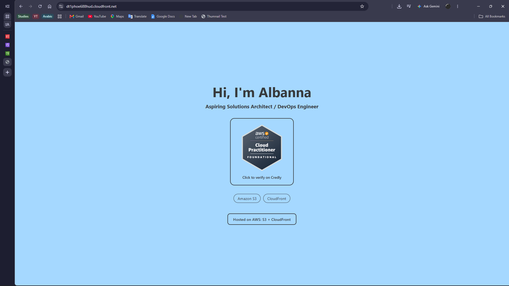
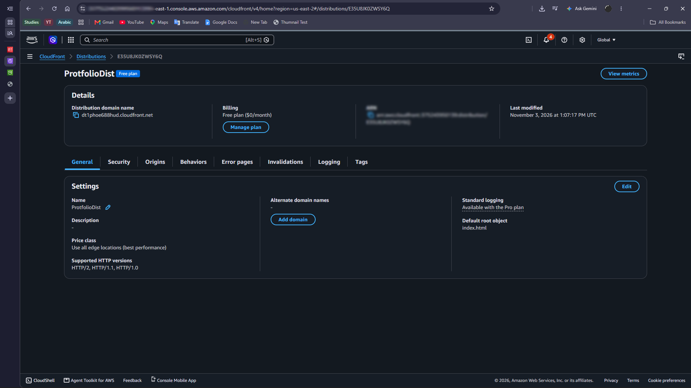
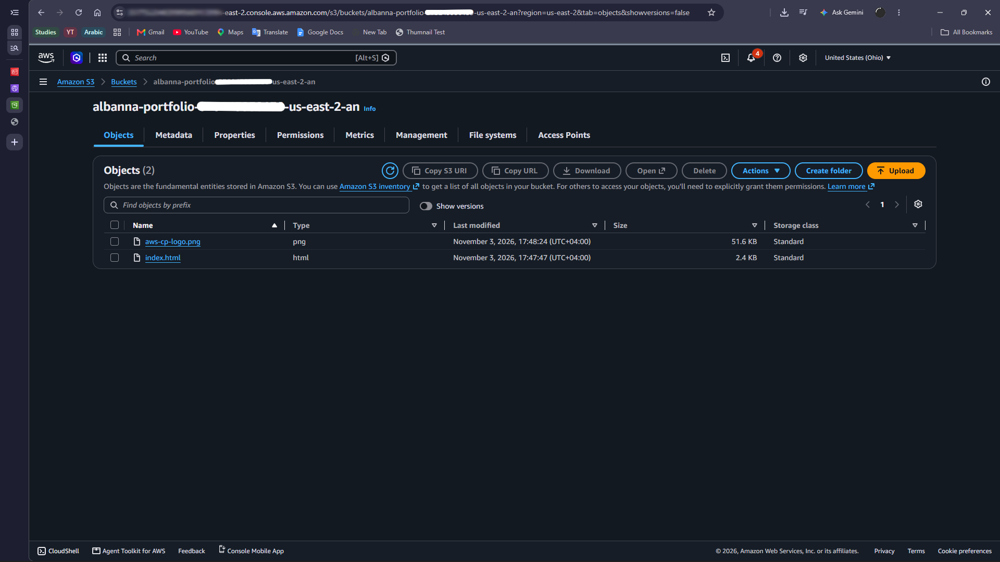
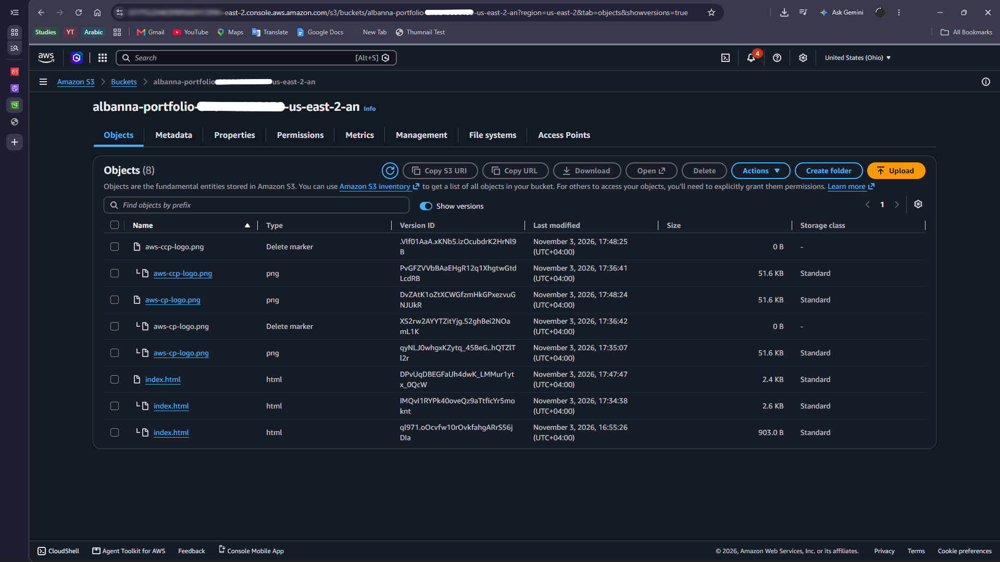
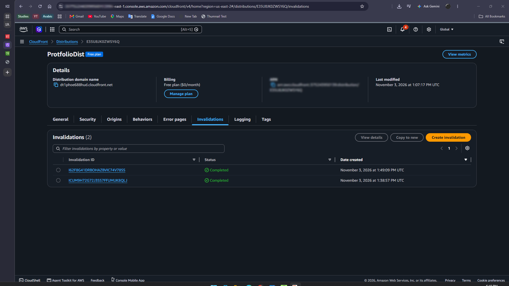
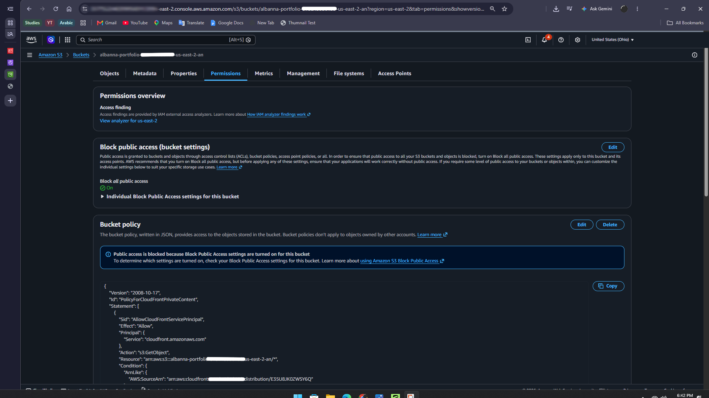

# AWS-Static-Personal-Website
Simple Static Website Created in AWS

A simple static portfolio website hosted on AWS.
The S3 Bucket is Private, and CloudFront delivers the site over HTTPS.
Site: https://dt1phoe688hud.cloudfront.net

## Architecture
### Architecture is as follows:
Visitor Opens the CloudFront URL -> 
  CloudFront delivers the page from the nearest edge location, or gets it from the S3 Bucket if it wasn't cached
 [S3 Bucket stays private; only CloudFront is allowed to read from it]

## AWS Services used
Amazon S3: Stores the Site's files (Index.html & the badge image)
Amazon CloudFront:Delivers the site over HTTPS, caches content globally

## Screenshots Description:
S1: Live Site Over HTTPS

  

S2: CloudFront Distribution Deployed

  

S3: S3 Bucket Contents

  

S4: S3 Bucket Contents with Versioning Enabled

  

S5: CloudFront Distribution Invalidations

  

S6: Block Public Access Enabled (Bucket Is Private)

  

  
## Key Things I've Learnt:
-  Why a private bucket plus CloudFront is better than public S3 website hosting (HTTPS, security, speed)
-  How CloudFront caching works and why invalidations are needed after updates
